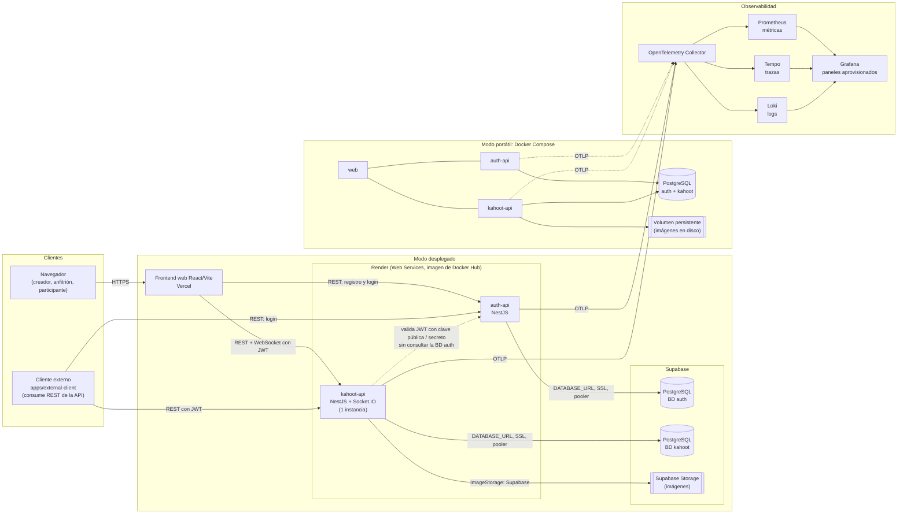
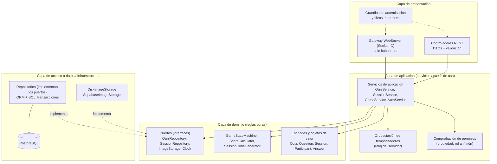

# Arquitectura

## 1. Vista de despliegue y observabilidad

Dos modos de ejecución con las mismas imágenes de Docker Hub: **desplegado** (Vercel + Render + Supabase) y **portátil** (Docker Compose en cualquier equipo con Git y Docker). La conexión a la base se elige solo con `DATABASE_URL`; el almacenamiento de imágenes, con una variable de entorno.

Notas:
- **Frontend (Vercel):** sitio estático; las URLs de ambas APIs y CORS se configuran por variables de entorno. Vercel no mantiene WebSockets, por eso no aloja el backend.
- **APIs (Render):** cada una es un Web Service que despliega su imagen de Docker Hub. `kahoot-api` corre en **una sola instancia**: el estado de la partida vive en memoria y se persiste en la base en cada transición. Los planes gratuitos se duermen; la demostración usa un plan que no duerma.
- **Base de datos:** cada servicio usa su propia base lógica (`auth`, `kahoot`). En Supabase se accede por el pooler con SSL; en Compose es un contenedor PostgreSQL con el mismo motor y versión.
- **Imágenes:** la interfaz `ImageStorage` tiene dos implementaciones: **disco** con volumen persistente (modo portátil u hosts con volumen) y **Supabase Storage** (Render gratuito, sin disco). `kahoot-api` siempre es la dueña de las imágenes y de su URL pública.
- **Autenticación entre servicios:** el JWT de `auth-api` lleva la audiencia de `kahoot-api`, que lo valida localmente (firma y `aud`) sin acceder a la base `auth`.
- **Observabilidad:** ambas APIs exportan por OTLP al Collector. En Compose, Prometheus, Tempo, Loki y Grafana corren localmente; en el despliegue se exporta a Grafana Cloud (nivel gratuito) o a un Grafana propio, sin cambiar el código.

## 2. Arquitectura N-Capas de cada API

Se aplica a `auth-api` y a `kahoot-api` (monolito modular por API, módulos por contexto: `auth`/`profiles`; `quizzes`/`sessions`/`game`).

### Regla de dependencia

Las dependencias de código solo apuntan **hacia abajo y hacia el dominio**:

1. **Presentación** depende de **aplicación**. Nunca llama a repositorios ni contiene reglas de negocio.
2. **Aplicación** depende de **dominio** y de los **puertos** (interfaces) declarados en el dominio. Orquesta transacciones, permisos y temporizadores.
3. **Dominio** no depende de ninguna otra capa ni de frameworks: sin HTTP, sin Socket.IO, sin ORM, sin reloj del sistema directo (se inyecta `Clock`). Por eso las reglas de puntaje, tiempo y respuesta única se prueban con pruebas unitarias puras.
4. **Acceso a datos** implementa los puertos del dominio (inversión de dependencia). Los repositorios son la **única** capa que habla con la base de datos y con el almacenamiento de imágenes.

| Capa | Puede usar | No puede usar |
|---|---|---|
| Presentación | Aplicación, DTOs | Dominio directamente para decidir reglas, repositorios, ORM |
| Aplicación | Dominio, puertos | Controladores, gateway, ORM concreto |
| Dominio | Solo el propio dominio | HTTP, WebSocket, ORM, `Date.now()` directo |
| Acceso a datos | Puertos del dominio, ORM, SDK de Supabase Storage | Presentación, servicios de aplicación |

Reglas de seguridad ubicadas por capa: la autenticación (JWT, handshake WS) se verifica en presentación; la **propiedad** del cuestionario y la identidad del anfitrión se comprueban en aplicación; la **respuesta correcta** se oculta antes del cierre en aplicación al construir los eventos; el servidor es la única fuente de tiempo y estado.
