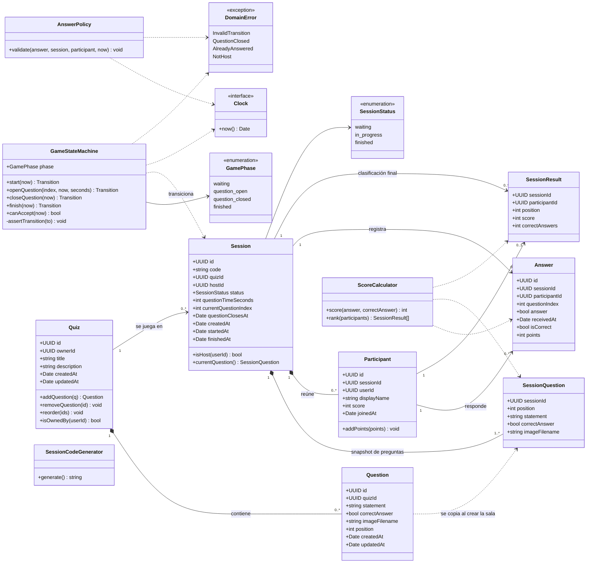
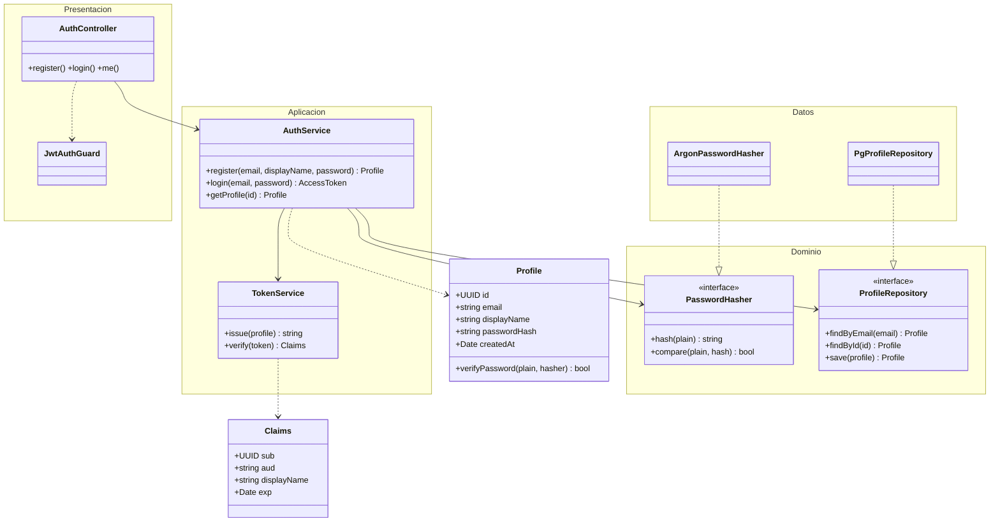

# Diagramas de clases

Los nombres de campos coinciden con el modelo de datos (`docs/modelo-datos.md`). Las clases de dominio no dependen de HTTP, Socket.IO ni del ORM; los repositorios se declaran como puertos (interfaces) y se implementan en la capa de acceso a datos.

## 1. Dominio de kahoot-api

Reglas clave del dominio:
- `GameStateMachine`: `waiting → question_open → question_closed → question_open ... → finished`. Una transición inválida lanza `DomainError.InvalidTransition`. `question_closes_at` lo fija el servidor al abrir la pregunta.
- `AnswerPolicy.validate`: rechaza si la fase no es `question_open`, si `now > questionClosesAt` (reloj del servidor) o si el participante ya respondió (además de la restricción única en base).
- `ScoreCalculator`: 1 punto por respuesta correcta, 0 por incorrecta o ausente; `rank` ordena por puntaje y produce `SessionResult` con los empates compartiendo lugar.

## 2. Servicios y repositorios por capa en kahoot-api

```mermaid
classDiagram
    direction TB

    namespace Presentacion {
        class QuizzesController {
            +create() +list() +get() +update() +remove()
            +addQuestion() +updateQuestion() +removeQuestion()
            +uploadImage()
        }
        class SessionsController {
            +create() +get() +results()
            +join() +start()
        }
        class GameGateway {
            +handleConnection(socket)
            +onJoin() +onStartGame()
            +onNextQuestion() +onCloseQuestion()
            +onSubmitAnswer() +onEndGame()
            +broadcast(event)
        }
        class JwtAuthGuard
        class WsAuthGuard
    }

    namespace Aplicacion {
        class QuizService {
            +createQuiz() +listMine() +updateQuiz()
            +deleteQuiz() +manageQuestions()
            -assertOwner(quiz, userId)
        }
        class SessionService {
            +createSession(quizId, hostId, seconds)
            +joinSession(code, user)
            +getResults(sessionId)
            -snapshotQuestions(quiz)
        }
        class GameService {
            +start() +openNext() +closeQuestion()
            +submitAnswer(sessionId, userId, answer)
            +finish() +syncState(sessionId, userId)
            +recoverTimers()
        }
        class QuestionTimer {
            +schedule(sessionId, closesAt)
            +cancel(sessionId)
        }
        class ImageService {
            +upload(file) string
            +validate(file)
        }
    }

    namespace Dominio {
        class GameStateMachine
        class ScoreCalculator
        class AnswerPolicy
        class SessionCodeGenerator
        class QuizRepository {
            <<interface>>
        }
        class SessionRepository {
            <<interface>>
        }
        class ParticipantRepository {
            <<interface>>
        }
        class AnswerRepository {
            <<interface>>
            +insertIfAbsent(answer) bool
        }
        class ResultRepository {
            <<interface>>
        }
        class ImageStorage {
            <<interface>>
            +save() +delete() +urlFor()
        }
        class Clock {
            <<interface>>
        }
    }

    namespace Datos {
        class PgQuizRepository
        class PgSessionRepository
        class PgParticipantRepository
        class PgAnswerRepository
        class PgResultRepository
        class DiskImageStorage
        class SupabaseImageStorage
        class SystemClock
    }

    QuizzesController --> QuizService
    QuizzesController --> ImageService
    SessionsController --> SessionService
    GameGateway --> GameService
    QuizzesController ..> JwtAuthGuard
    SessionsController ..> JwtAuthGuard
    GameGateway ..> WsAuthGuard

    QuizService --> QuizRepository
    SessionService --> QuizRepository
    SessionService --> SessionRepository
    SessionService --> ParticipantRepository
    SessionService --> SessionCodeGenerator
    GameService --> GameStateMachine
    GameService --> AnswerPolicy
    GameService --> ScoreCalculator
    GameService --> SessionRepository
    GameService --> ParticipantRepository
    GameService --> AnswerRepository
    GameService --> ResultRepository
    GameService --> QuestionTimer
    GameService --> Clock
    ImageService --> ImageStorage

    PgQuizRepository ..|> QuizRepository
    PgSessionRepository ..|> SessionRepository
    PgParticipantRepository ..|> ParticipantRepository
    PgAnswerRepository ..|> AnswerRepository
    PgResultRepository ..|> ResultRepository
    DiskImageStorage ..|> ImageStorage
    SupabaseImageStorage ..|> ImageStorage
    SystemClock ..|> Clock
```

Notas:
- `GameService.submitAnswer` valida con `AnswerPolicy`, calcula con `ScoreCalculator`, y en una transacción hace `AnswerRepository.insertIfAbsent` (`INSERT ... ON CONFLICT DO NOTHING`); solo si insertó suma puntos al participante. Validación y cierre se serializan por sala.
- `GameService.recoverTimers` reprograma los temporizadores al arrancar leyendo `sessions` con `status = 'in_progress'`.
- `SessionService.createSession` genera el código con reintento ante colisión y copia las preguntas a `session_questions`.

## 3. Servicio de autenticación (auth-api)

Notas:
- `TokenService.issue` incluye la audiencia de `kahoot-api` en `aud` y el `sub` con el `id` del perfil; `kahoot-api` valida el token sin consultar la base `auth`.
- La unicidad del correo (`citext`) se garantiza en la base; `register` traduce la violación a un error de dominio "correo ya registrado".
- `password_hash` nunca sale de la API: los DTO de respuesta excluyen ese campo.
