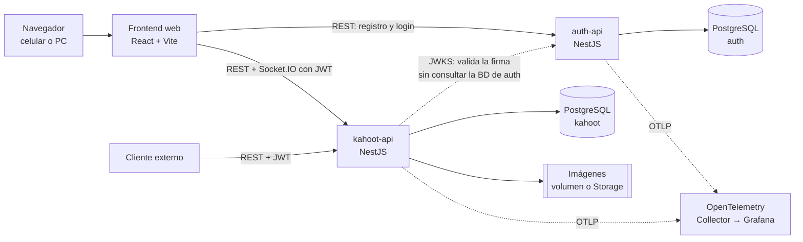
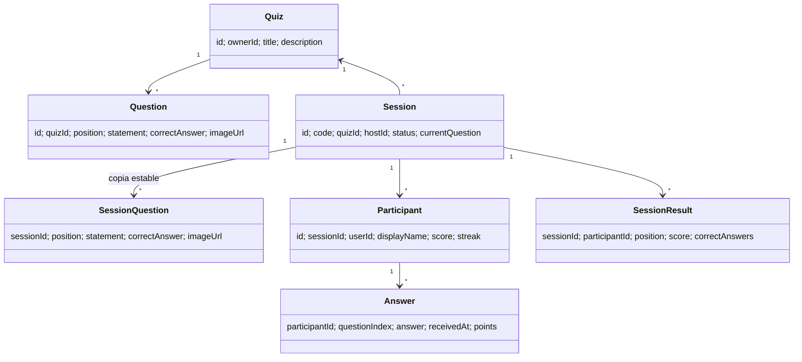

# Especificación de ProfeLink Kahoot

Evaluaciones en vivo tipo Kahoot para ProfeLink (EIF400, II Ciclo 2026). Este documento resume el alcance, las reglas, la arquitectura y los contratos. El detalle vive en los documentos enlazados y las especificaciones formales en `openspec/specs/`.

| Tema | Documento |
|---|---|
| Diagramas de arquitectura (despliegue y observabilidad) | [diagramas/arquitectura.md](diagramas/arquitectura.md) |
| Diagramas de clases | [diagramas/clases.md](diagramas/clases.md) |
| Modelo de datos | [modelo-datos.md](modelo-datos.md) |
| API REST (OpenAPI) | [`auth-api.yaml`](../packages/contracts/openapi/auth-api.yaml), [`kahoot-api.yaml`](../packages/contracts/openapi/kahoot-api.yaml) |
| Eventos en vivo | [`packages/contracts/events/README.md`](../packages/contracts/events/README.md) y sus esquemas |
| Requisitos formales | [`openspec/specs/`](../openspec/specs) (identidad, cuestionarios, sala, partida en vivo, puntaje, interfaz) |
| Evidencia de las comprobaciones | [`docs/evidencia/`](evidencia) |

## 1. Alcance

**Qué resuelve.** Durante una clase el docente lanza una evaluación corta: crea o reutiliza un cuestionario, abre una sala con código, los estudiantes responden Verdadero o Falso desde el celular y ven al instante la respuesta correcta y la clasificación.

**Dentro del alcance**
- Registro, inicio de sesión y nombre visible durante el juego.
- Crear, consultar, editar y eliminar cuestionarios y preguntas, con imagen opcional por pregunta.
- Salas con código, lobby, partida en vivo, resultados guardados y consulta de resultados por API.
- Interfaz en español e inglés para computadora y celular.
- Dos servicios independientes (autenticación y actividades), cada uno con OpenAPI/Scalar y observabilidad con OpenTelemetry y Grafana.
- Ejecución reproducible con Docker Compose, imágenes en Docker Hub y despliegue en Vercel, Render y Supabase.
- Un cliente externo que consume la API por red.

**Fuera del alcance**
- Tipos de pregunta distintos de Verdadero o Falso.
- Recuperación de contraseña, roles administrativos y verificación de correo.
- Escalar la partida en vivo a varias instancias del servicio de actividades (ver los límites en la sección 9).

## 2. Actores y funciones

| Actor | Qué puede hacer |
|---|---|
| Visitante | Registrarse e iniciar sesión |
| Creador (cualquier persona con cuenta) | Administrar **sus** cuestionarios y preguntas, subir imágenes |
| Anfitrión | El creador que abre una sala: ve el lobby, inicia la partida, cierra preguntas y avanza |
| Participante | Unirse con perfil y código, responder, ver su resultado y la clasificación |
| Cliente externo | Consultar una sesión y sus resultados por la API con un token válido |

## 3. Reglas del juego

| Regla | Detalle |
|---|---|
| Propiedad | Solo el propietario modifica sus cuestionarios y preguntas y controla su sala. Un participante no puede modificar preguntas ni controlar una partida ajena |
| Cuestionario estable | Al crear la sala se toma una copia (snapshot) de las preguntas. Editar el cuestionario después no cambia una partida en curso |
| Una pregunta a la vez | `waiting` → `question_open` → `question_closed` → siguiente o `finished`. Solo el anfitrión avanza |
| Tiempo | El servidor fija `closesAt` y cierra por temporizador. El cliente nunca decide si una respuesta llegó a tiempo |
| Respuesta única | Un participante responde una vez por pregunta. Un reenvío no suma de nuevo (`already_answered`) |
| Respuesta tardía | Tras `closesAt` según el reloj del servidor se rechaza (`late`); con la pregunta cerrada se rechaza (`closed`) |
| Secreto | La respuesta correcta solo viaja en el cierre de la pregunta. Nunca se envía antes a los participantes |
| Puntaje | Por acierto, 1000 puntos si el servidor mide menos de 500 ms desde la apertura y, en otro caso, `round((1 - (elapsedMs / duración) / 2) * 1000)`, es decir 500..1000. Error o sin respuesta: 0. La racha de aciertos es visual y no suma puntos |
| Clasificación | Puntaje descendente; los empates comparten posición. Se guarda al terminar |
| Reconexión | Al reconectar se reasocia por identidad y se envía `state_sync`: no se duplica la participación ni el puntaje |
| Aislamiento | Los mensajes y resultados de una sala nunca llegan a otra (sala lógica `session:<código>`) |
| Imágenes | Se valida formato y tamaño (máximo 2 MiB por defecto). Se guardan en almacenamiento persistente y se sirven públicamente por URL |

## 4. Arquitectura

### 4.1 Estilo: microservicios con frontend separado

Tres piezas desplegables por separado, que se comunican por contratos explícitos:

**Por qué.** El enunciado exige que la autenticación sea un proyecto aparte que reconoce como audiencia al servicio de actividades, y que este se despliegue y consuma de forma independiente.

- **auth-api** emite un JWT (RS256) con `aud=kahoot-api` y publica la clave pública en `/.well-known/jwks.json`. No conoce el dominio del juego.
- **kahoot-api** valida el token con esa clave pública, de modo que **no consulta la base de auth ni llama a auth-api en cada solicitud**. Posee sus datos, imágenes y reglas.
- **El frontend** solo conoce los contratos HTTP y de eventos; cada servicio tiene su propia base lógica, sin acceso cruzado.
- **Un cliente distinto** (`apps/external-client`) usa la misma API pública sin importar código ni tocar la base.

**Costos aceptados.** Más piezas que operar (dos servicios, dos bases), necesidad de contratos versionados y de configurar CORS y audiencias. Se mitigan con Compose y scripts de inicio, un monorepo con contratos primero, y tipos generados desde el OpenAPI.

### 4.2 Arquitectura interna: N-Capas

Cada API se organiza en **presentación → aplicación → dominio ← datos**, y la regla de dependencias se verifica automáticamente en `npm run lint`.

| Capa | Qué contiene en kahoot-api |
|---|---|
| Presentación | Controladores REST, gateway de Socket.IO, validación de entrada, mapeo a las formas del contrato |
| Aplicación | Casos de uso: cuestionarios, sesiones, flujo de la partida, temporizadores. Dependen de puertos (interfaces) |
| Dominio | Entidades, estados de la sala y **reglas puras**: puntaje, tiempo, respuesta única, clasificación. Sin HTTP, sin base de datos |
| Datos | Repositorios PostgreSQL (TypeORM), almacenamiento de imágenes, migraciones. Implementan los puertos |

**Beneficio:** las reglas del juego se prueban sin levantar HTTP ni PostgreSQL, y el canal en vivo y la API REST reutilizan los mismos casos de uso. **Costo:** más archivos y mapeos entre capas para un dominio pequeño.

Diagramas completos: [arquitectura](diagramas/arquitectura.md) y [clases](diagramas/clases.md).

### 4.3 Diagrama de clases (resumen del dominio)

La versión completa, con servicios, puertos, repositorios y el servicio de autenticación, está en [diagramas/clases.md](diagramas/clases.md).

## 5. Modelo de datos

PostgreSQL con dos bases lógicas independientes:

| Base | Tablas |
|---|---|
| `auth` | `profiles` |
| `kahoot` | `quizzes`, `questions`, `sessions`, `session_questions`, `participants`, `answers`, `session_results` |

Restricciones relevantes: respuesta única por `(sesión, participante, pregunta)`, código de sala único, copia estable de preguntas por sesión y migraciones aplicadas al arrancar. Diagramas ER, columnas y reglas: [modelo-datos.md](modelo-datos.md).

## 6. API REST

Prefijo `/api/v1`. Todos los endpoints exigen `Authorization: Bearer <JWT>` salvo `GET /health` y `GET /images/{filename}`. Los errores usan el formato de problema del contrato. Cada servicio publica su documentación Scalar en `/docs`.

**auth-api** (`packages/contracts/openapi/auth-api.yaml`)

| Método y ruta | Uso |
|---|---|
| `POST /auth/register` | Registrar un perfil |
| `POST /auth/login` | Iniciar sesión y obtener el JWT |
| `GET /auth/me` | Perfil del usuario autenticado |
| `GET /.well-known/jwks.json` | Clave pública para validar tokens |
| `GET /health` | Estado del servicio |

**kahoot-api** (`packages/contracts/openapi/kahoot-api.yaml`)

| Recurso | Operaciones |
|---|---|
| `/quizzes` | Listar y crear los cuestionarios propios |
| `/quizzes/{quizId}` | Consultar, actualizar y eliminar |
| `/quizzes/{quizId}/questions` | Listar y crear preguntas |
| `/quizzes/{quizId}/questions/{questionId}` | Consultar, actualizar y eliminar |
| `/quizzes/{quizId}/questions/{questionId}/image` | Subir y quitar la imagen |
| `/images/{filename}` | Leer una imagen (público) |
| `/sessions` | Listar las salas propias y crear una |
| `/sessions/{code}` | Consultar una sala |
| `/sessions/{code}/join` | Unirse como participante (idempotente) |
| `/sessions/{code}/participants` | Ver el lobby |
| `/sessions/{code}/results` | Clasificación final (solo sesiones terminadas) |

## 7. Eventos en vivo

Socket.IO, namespace `/game` de kahoot-api. El catálogo completo, con esquemas JSON validados, secuencias y reglas, está en [`packages/contracts/events/README.md`](../packages/contracts/events/README.md).

- **Autenticación:** el JWT de auth-api viaja en el handshake (`auth: { token }`). Sin token válido se rechaza la conexión (`connect_error: unauthorized`). La identidad sale del token, nunca de los payloads, y quién es anfitrión lo decide el servidor.
- **Recuperación de estado:** tras reconectar el cliente repite `session:join { code }` y recibe `state_sync` con el estado completo (sin la respuesta correcta si la pregunta sigue abierta). La cuenta regresiva se calcula con `closesAt - serverTime`.
- **Límite de eventos:** cada conexión admite un máximo de eventos por segundo (`LIVE_MAX_EVENTS_PER_SECOND`); al excederlo se desconecta.

| Cliente → servidor | Quién | Respuesta |
|---|---|---|
| `session:join` | Autenticado | `state_sync` al emisor; `participant:joined` a la sala si es nuevo |
| `session:start` | Anfitrión | `session:started` y `question:opened` |
| `question:next` | Anfitrión | `question:opened` o `session:finished` |
| `question:close` | Anfitrión | `question:closed` |
| `answer:submit` | Participante | `answer:accepted` o `answer:rejected` |
| `session:leave` | Participante | `participant:left` a la sala |

| Servidor → cliente | Destino |
|---|---|
| `state_sync` | Solo el socket que se une o reconecta |
| `participant:joined`, `participant:left` | Sala |
| `session:started`, `question:opened` | Sala (sin la respuesta correcta) |
| `answer:accepted`, `answer:rejected` | Solo el emisor |
| `question:closed` | Sala (**único** evento con `correctAnswer`) |
| `session:finished` | Sala (clasificación final) |
| `error` | Solo el emisor del comando fallido |

## 8. Seguridad

- Autenticación con JWT firmado (RS256) y audiencia `kahoot-api`; la clave privada nunca sale de auth-api y no se versiona.
- Contraseñas con hash (argon2); validación de entrada en todas las rutas y eventos.
- El canal en vivo exige token; los comandos de control (`session:start`, `question:next`, `question:close`) solo los acepta el anfitrión.
- La respuesta correcta no se envía antes del cierre; el cliente nunca decide puntajes ni tiempos.
- CORS restringido a los orígenes configurados. Secretos solo en variables de entorno; el repositorio solo versiona `.env.example`.
- Los registros (logs) no incluyen contraseñas, tokens ni datos sensibles.

## 9. Observabilidad, despliegue y límites

- **Observabilidad:** ambas APIs exportan trazas y métricas por OpenTelemetry (OTLP) a un Collector que alimenta Tempo y Prometheus; los registros van a Loki; Grafana trae paneles aprovisionados (solicitudes, latencia, errores y conexiones activas, además de métricas del juego). Se activa con `--observability`.
- **Modos de ejecución con las mismas imágenes:** portátil con Docker Compose (PostgreSQL local, imágenes en volumen) y desplegado en Vercel (web), Render (APIs desde Docker Hub) y Supabase (base de datos e imágenes). El almacenamiento de imágenes se elige por variable de entorno.
- **Una sola instancia de kahoot-api:** el estado de la partida en vivo (temporizadores y salas) vive en el proceso y en la base; escalar a varias instancias exigiría un adaptador compartido para Socket.IO y coordinar los temporizadores. Está documentado como límite conocido.
- **Capacidad medida:** hasta **400 participantes simultáneos** con 0,5 CPU y 512 MiB sin errores; a 800 falla el criterio de latencia de cierre. Detalle, hardware y método en [`apps/kahoot-api/LOAD-VERIFICATION.md`](../apps/kahoot-api/LOAD-VERIFICATION.md). Es una medición local, no representa el hardware de Render.

## 10. Calidad y comprobaciones obligatorias

Pruebas unitarias de las reglas de dominio (puntaje, tiempo, respuesta única), de integración con PostgreSQL real y e2e con Playwright contra la solución en Compose.

| Comprobación | Dónde se verifica |
|---|---|
| Acceso y permisos | Pruebas de integración de kahoot-api y e2e de acceso |
| Juego simultáneo (dos salas) | Pruebas de integración en vivo y e2e de dos salas |
| Respuestas válidas (única, tardía, revelación) | Pruebas de dominio e integración en vivo y e2e |
| Reconexión | Pruebas en vivo y e2e de reconexión |
| Persistencia tras reiniciar contenedores | e2e de persistencia |
| Consumo independiente | Pruebas de `apps/external-client` y demostración contra la API local |

Los resultados, los participantes probados y las limitaciones conocidas se registran en [`docs/evidencia/`](evidencia).

## 11. Trazabilidad con el enunciado

| Entregable | Dónde |
|---|---|
| Código de frontend y backend, Dockerfiles, Compose, `.env.example`, script de inicio | `apps/`, `infra/`, `compose.yaml`, `compose.build.yaml`, `.env.example`, `start.sh`, `start.ps1` |
| Imágenes en Docker Hub | `profelink/profelink-{auth-api,kahoot-api,web}` (pendiente de publicar) |
| README con URLs, inicio, cuentas de prueba y demostración | [README.md](../README.md) |
| Especificación con alcance, reglas, diagramas, modelo de datos, API y eventos | Este documento y los enlazados |
| Spec OpenSpec archivada en los PR | `openspec/changes/archive/` y `openspec/specs/` |
| Evidencia de comprobaciones | [`docs/evidencia/`](evidencia) |
| Aportes de cada integrante | Tabla en el [README](../README.md) y el historial de Git |
