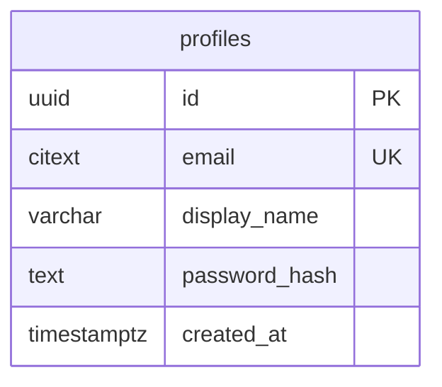
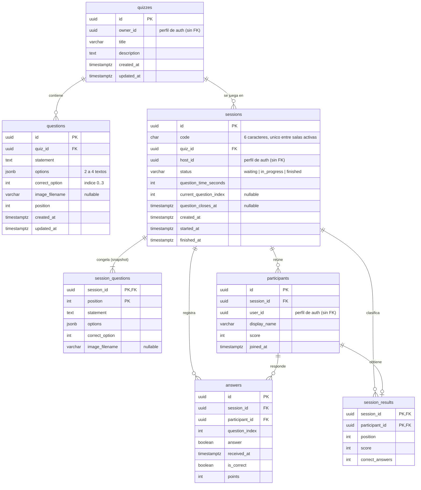

# Modelo de datos

Cada servicio tiene su **propia base lógica** de PostgreSQL (misma versión en Docker Compose y en Supabase). No hay claves foráneas entre bases: `kahoot-api` guarda identificadores de perfil (`owner_id`, `host_id`, `user_id`) como `uuid` que provienen del JWT emitido por `auth-api`, sin consultar la base `auth`. Solo se usa SQL estándar y migraciones versionadas; no se usan funciones propias de Supabase.

| Servicio | Base lógica | Tablas |
|---|---|---|
| `auth-api` | `auth` | `profiles` |
| `kahoot-api` | `kahoot` | `quizzes`, `questions`, `sessions`, `session_questions`, `participants`, `answers`, `session_results` |

Convenciones: claves primarias `uuid` (`gen_random_uuid()`), fechas `timestamptz` en UTC, nombres en `snake_case` en inglés.

---

## 1. Base `auth` (auth-api)

### Diagrama ER

### Tabla `profiles`

| Columna | Tipo PostgreSQL | Nulo | Restricciones / notas |
|---|---|---|---|
| `id` | `uuid` | no | PK, `DEFAULT gen_random_uuid()`. Es el `sub` del JWT. |
| `email` | `citext` | no | `UNIQUE`; `citext` hace la unicidad insensible a mayúsculas. Requiere `CREATE EXTENSION citext`. |
| `display_name` | `varchar(40)` | no | `CHECK (char_length(trim(display_name)) >= 2)`. |
| `password_hash` | `text` | no | Hash con sal (argon2 o bcrypt); nunca la contraseña. No se expone en la API. |
| `created_at` | `timestamptz` | no | `DEFAULT now()`. |

Índices: `profiles_pkey (id)` y `profiles_email_key (email)` (único, generado por la restricción). No se necesitan más: el login busca por `email`.

---

## 2. Base `kahoot` (kahoot-api)

### Diagrama ER

Nota: `session_questions` se relaciona con `answers` y `session_results` de forma lógica por `(session_id, position = question_index)`; no se declara FK compuesta para no acoplar el borrado de respuestas al snapshot.

### Tabla `quizzes`

| Columna | Tipo | Nulo | Restricciones / notas |
|---|---|---|---|
| `id` | `uuid` | no | PK, `gen_random_uuid()`. |
| `owner_id` | `uuid` | no | Id del perfil creador (claim `sub`). Sin FK entre bases. |
| `title` | `varchar(120)` | no | `CHECK (char_length(trim(title)) >= 1)`. |
| `description` | `text` | sí | Descripción opcional. |
| `created_at` | `timestamptz` | no | `DEFAULT now()`. |
| `updated_at` | `timestamptz` | no | `DEFAULT now()`; se actualiza en cada edición. |

Índices: PK; `quizzes_owner_idx (owner_id, created_at DESC)` para listar "mis cuestionarios".

### Tabla `questions`

| Columna | Tipo | Nulo | Restricciones / notas |
|---|---|---|---|
| `id` | `uuid` | no | PK. |
| `quiz_id` | `uuid` | no | FK → `quizzes(id)` `ON DELETE CASCADE`. |
| `statement` | `text` | no | Enunciado; `CHECK (char_length(trim(statement)) >= 1)`. |
| `options` | `jsonb` | no | Arreglo de 2 a 4 textos (Verdadero/Falso es `["Verdadero","Falso"]`). |
| `correct_option` | `integer` | no | Índice (base 0) de la opción correcta; debe ser menor que el número de opciones. |
| `image_filename` | `varchar(255)` | sí | Nombre del archivo en `ImageStorage` (disco o Supabase Storage); la URL pública la construye la API. |
| `position` | `integer` | no | Orden dentro del cuestionario, `CHECK (position >= 0)`. |
| `created_at` | `timestamptz` | no | `DEFAULT now()`. |
| `updated_at` | `timestamptz` | no | `DEFAULT now()`. |

Restricciones e índices: `UNIQUE (quiz_id, position)` (crea el índice que acelera la lectura ordenada de un cuestionario). Para reordenar se usa la restricción `DEFERRABLE INITIALLY DEFERRED` y se actualizan las posiciones dentro de una transacción.

### Tabla `sessions` (salas / partidas)

| Columna | Tipo | Nulo | Restricciones / notas |
|---|---|---|---|
| `id` | `uuid` | no | PK. |
| `code` | `char(6)` | no | Código de sala sin caracteres ambiguos (sin `0/O/1/I`). Único **solo entre salas activas** (ver índice parcial). `CHECK (code ~ '^[A-HJ-NP-Z2-9]{6}$')`. |
| `quiz_id` | `uuid` | no | FK → `quizzes(id)` `ON DELETE RESTRICT`: un cuestionario con salas no se borra físicamente; se copia el contenido al snapshot, por lo que el borrado lógico o la desvinculación se resuelve en la capa de aplicación. |
| `host_id` | `uuid` | no | Perfil del anfitrión (claim `sub`). Sin FK entre bases. |
| `status` | `varchar(16)` | no | `CHECK (status IN ('waiting','in_progress','finished'))`, `DEFAULT 'waiting'`. |
| `question_time_seconds` | `integer` | no | `CHECK (question_time_seconds BETWEEN 5 AND 120)`. |
| `current_question_index` | `integer` | sí | `NULL` mientras `waiting`; índice base 0 de la pregunta en curso. |
| `question_closes_at` | `timestamptz` | sí | Instante de cierre fijado por el servidor para la pregunta abierta. `NULL` si no hay pregunta abierta. |
| `created_at` | `timestamptz` | no | `DEFAULT now()`. |
| `started_at` | `timestamptz` | sí | Se fija al pasar a `in_progress`. |
| `finished_at` | `timestamptz` | sí | Se fija al pasar a `finished`. |

Índices y restricciones:
- `sessions_code_active_uk`: `CREATE UNIQUE INDEX ... ON sessions (code) WHERE status <> 'finished'`. Garantiza que dos salas activas nunca compartan código y permite reutilizarlo cuando la sala termina. Si la inserción colisiona, el caso de uso reintenta con otro código.
- `sessions_host_idx (host_id, created_at DESC)` para el historial del anfitrión.
- `sessions_quiz_idx (quiz_id)` por la FK.
- `CHECK` de coherencia: `(status = 'waiting' AND current_question_index IS NULL) OR status <> 'waiting'`, y `question_closes_at IS NULL OR status = 'in_progress'`.

Relación con la máquina de estados del dominio: la columna `status` solo guarda las tres fases persistentes. La fase fina del dominio (`waiting → question_open → question_closed → ... → finished`) se deriva: dentro de `in_progress`, hay pregunta abierta si `question_closes_at` no es nulo y no hay pregunta abierta (cerrada, a la espera de la siguiente) si es nulo. Se escribe en cada transición para poder recuperar la partida tras reconexión o reinicio.

### Tabla `session_questions` (snapshot estable)

| Columna | Tipo | Nulo | Restricciones / notas |
|---|---|---|---|
| `session_id` | `uuid` | no | FK → `sessions(id)` `ON DELETE CASCADE`; parte de la PK. |
| `position` | `integer` | no | Orden de la pregunta en la partida (base 0); parte de la PK. Coincide con `question_index`. |
| `statement` | `text` | no | Copia del enunciado al crear la sala. |
| `options` | `jsonb` | no | Copia de las opciones. |
| `correct_option` | `integer` | no | Copia del índice de la opción correcta. |
| `image_filename` | `varchar(255)` | sí | Copia del nombre de imagen. |

PK: `(session_id, position)`. Sin FK a `questions`: es intencional, para que borrar o editar la pregunta original no altere la partida.

**Cómo el snapshot mantiene estable el cuestionario.** Al crear la sala, en una sola transacción se insertan en `session_questions` todas las preguntas del cuestionario (enunciado, respuesta correcta, imagen y posición). Durante toda la partida el dominio lee las preguntas **únicamente** de `session_questions`, nunca de `questions`. Así, si el creador edita, reordena o borra preguntas mientras hay una partida en curso o ya terminada, la sala conserva exactamente lo que se jugó, los puntajes siguen siendo coherentes con lo respondido y el historial permanece reproducible. Los archivos de imagen referenciados por un snapshot no se eliminan mientras exista una sala que los use.

### Tabla `participants`

| Columna | Tipo | Nulo | Restricciones / notas |
|---|---|---|---|
| `id` | `uuid` | no | PK. |
| `session_id` | `uuid` | no | FK → `sessions(id)` `ON DELETE CASCADE`. |
| `user_id` | `uuid` | no | Perfil de `auth` (claim `sub`). Sin FK entre bases. |
| `display_name` | `varchar(40)` | no | Nombre mostrado en la sala. |
| `score` | `integer` | no | `DEFAULT 0`, `CHECK (score >= 0)`. Acumulado denormalizado; se incrementa en la misma transacción que inserta la respuesta. |
| `joined_at` | `timestamptz` | no | `DEFAULT now()`. |

Restricciones e índices: `UNIQUE (session_id, user_id)`: la reconexión reasocia al mismo participante por identidad y nunca crea uno nuevo; también impide unirse dos veces. El índice del `UNIQUE` sirve para buscar por sala. `participants_session_score_idx (session_id, score DESC)` para clasificación en vivo.

### Tabla `answers`

| Columna | Tipo | Nulo | Restricciones / notas |
|---|---|---|---|
| `id` | `uuid` | no | PK. |
| `session_id` | `uuid` | no | FK → `sessions(id)` `ON DELETE CASCADE`. |
| `participant_id` | `uuid` | no | FK → `participants(id)` `ON DELETE CASCADE`. |
| `question_index` | `integer` | no | Índice base 0; corresponde a `session_questions.position`. `CHECK (question_index >= 0)`. |
| `option_index` | `integer` | no | Índice (0..3) de la opción elegida. |
| `received_at` | `timestamptz` | no | Reloj **del servidor** al recibir la respuesta; solo se acepta si `received_at <= question_closes_at`. |
| `is_correct` | `boolean` | no | Calculado por el servidor al registrar. |
| `points` | `integer` | no | `CHECK (points >= 0)`; 1 si es correcta, 0 si no (puntaje básico). |

Restricciones e índices:
- **`UNIQUE (session_id, participant_id, question_index)`**: garantiza una sola respuesta por participante y pregunta.
- `answers_session_question_idx (session_id, question_index)` para contar y revelar resultados al cerrar una pregunta.
- `answers_participant_idx (participant_id)` por la FK.
- La coherencia `participant_id` pertenece a `session_id` se verifica en el dominio al insertar (o con FK compuesta `(participant_id, session_id)` contra `UNIQUE (id, session_id)` en `participants`, opción recomendada).

**Cómo la restricción única evita sumar puntos dos veces.** El registro de una respuesta es un solo `INSERT ... ON CONFLICT (session_id, participant_id, question_index) DO NOTHING` dentro de una transacción. Solo si la fila se inserta (una fila afectada) se ejecuta `UPDATE participants SET score = score + points`. Si el cliente reenvía el mismo mensaje, cambia de opinión, abre dos pestañas o llegan dos mensajes concurrentes, el segundo `INSERT` no inserta nada, no se actualiza el puntaje y la API responde con el resultado ya registrado (idempotente). La garantía la da la base de datos, no el código de la aplicación, por lo que también se cumple ante condiciones de carrera. Además, el puntaje del participante siempre puede recomputarse como `SUM(points)` de sus `answers`, que sirve como verificación.

### Tabla `session_results`

Resultados finales **persistidos al terminar la partida** (clasificación congelada). Se escribe una sola vez, en la misma transacción que marca la sala `finished`, a partir de `participants.score` y `answers`. Se consulta tras reinicios sin recalcular.

| Columna | Tipo | Nulo | Restricciones / notas |
|---|---|---|---|
| `session_id` | `uuid` | no | FK → `sessions(id)` `ON DELETE CASCADE`; parte de la PK. |
| `participant_id` | `uuid` | no | FK → `participants(id)` `ON DELETE CASCADE`; parte de la PK. |
| `position` | `integer` | no | Lugar en la clasificación (1 = primero); `CHECK (position >= 1)`. Los empates comparten lugar (ranking denso por `score`, desempate informativo por menor tiempo total). |
| `score` | `integer` | no | Puntaje final (copia de `participants.score`). |
| `correct_answers` | `integer` | no | Cantidad de respuestas correctas (`COUNT` de `answers` con `is_correct`). |

PK `(session_id, participant_id)`; índice `session_results_ranking_idx (session_id, position)`.

---

## 3. Reglas transversales

| Regla | Mecanismo en la base |
|---|---|
| Una respuesta por participante y pregunta | `UNIQUE (session_id, participant_id, question_index)` + `ON CONFLICT DO NOTHING` |
| Un participante por usuario y sala | `UNIQUE (session_id, user_id)` |
| Orden de preguntas sin huecos duplicados | `UNIQUE (quiz_id, position)` |
| Código de sala único entre salas activas | Índice único parcial `WHERE status <> 'finished'` |
| Partida inmune a ediciones del cuestionario | Tabla `session_questions` (snapshot) sin FK a `questions` |
| Resultados que sobreviven a reinicios | `session_results` escrita al finalizar, más estado en `sessions` en cada transición |
| La respuesta correcta no llega antes del cierre | `correct_option` solo se lee en el cierre; las respuestas de pregunta abierta no la exponen (regla de aplicación) |
| Datos de otro servicio sin acoplamiento | `owner_id`, `host_id`, `user_id` son `uuid` sin FK; la identidad viene del JWT |

## 4. Migraciones

Las migraciones SQL se versionan por servicio (una carpeta por base) y se prueban tanto contra el contenedor PostgreSQL de Compose como contra Supabase. El seed de demostración (usuarios, cuestionarios y una sala de ejemplo) se aplica después de las migraciones.
