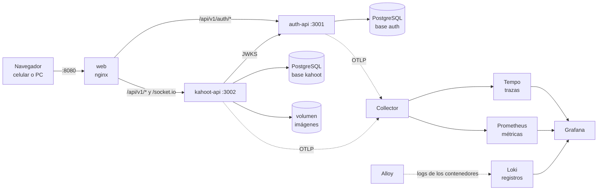

# Infraestructura y ejecución con Docker

Con **Git, Docker y Docker Compose v2** instalados basta clonar el repositorio y ejecutar un script. No hace falta Node ni .NET en la máquina.

```bash
./start.sh                  # Linux / macOS / Git Bash
```
```powershell
.\start.ps1                 # Windows PowerShell
```

La primera vez el script crea `.env` desde `.env.example`, genera las contraseñas que falten (PostgreSQL, usuario demo y Grafana), construye las imágenes, inicia todo, carga los datos de demostración e imprime las direcciones y las credenciales del usuario demo.

## Opciones

| Bash | PowerShell | Efecto |
|---|---|---|
| `--images` | `-Images` | Usa las imágenes de Docker Hub en lugar de construirlas |
| `--observability` | `-Observability` | Agrega Grafana, Prometheus, Tempo, Loki y el Collector |
| `--lan` | `-Lan` | Detecta la IP de la máquina y la usa como `PUBLIC_URL` (para jugar desde celulares) |
| `--public-url URL` | `-PublicUrl URL` | Usa una URL concreta |
| `--debug-controls` | `-DebugControls` | Muestra el botón "simular reconexión" (demostración) |

Detener: `./stop.sh` (conserva los datos) o `./stop.sh --purge` (borra todo, pide confirmación). En PowerShell: `.\stop.ps1` y `.\stop.ps1 -Purge`.

## Qué se levanta



- **Un solo origen.** El navegador solo habla con `web` (puerto 8080). nginx reenvía `/api/v1/auth/*` a `auth-api`, el resto de `/api/v1/*` y `/socket.io/` a `kahoot-api`. Por eso la imagen de la web no lleva URLs fijas y funciona en cualquier equipo o IP, sin CORS.
- **PostgreSQL** con dos bases lógicas (`auth` y `kahoot`) en un volumen persistente.
- **Claves JWT:** `auth-api` genera un par RSA la primera vez y lo guarda en un volumen; no hay secretos en el repositorio y los tokens siguen siendo válidos tras reiniciar.
- **Migraciones:** ambas APIs las aplican al arrancar.
- **Datos de demostración:** el usuario demo y el cuestionario "Programación y paradigmas" (5 preguntas, 2 con imagen). Se cargan con `docker compose run`, son idempotentes y respetan lo que el usuario haya editado o eliminado.

## Puertos

| Servicio | Puerto | Publicado en |
|---|---|---|
| web | 8080 | `WEB_BIND` (por defecto todas las interfaces, para jugar desde la red) |
| auth-api (`/docs`) | 3001 | `API_BIND` (por defecto solo `127.0.0.1`) |
| kahoot-api (`/docs`) | 3002 | `API_BIND` |
| Grafana (perfil `observability`) | 3000 | `API_BIND` |

PostgreSQL no se publica fuera de la red interna de Compose.

## Varias copias del repositorio en la misma máquina

Cada copia usa su **propio proyecto de Compose**, `rubymind-<nombre de la carpeta>`, que `start.sh` / `start.ps1` guardan en `.env` como `COMPOSE_PROJECT_NAME`. Así dos copias (por ejemplo dos carpetas de trabajo, o la de un compañero y la tuya) **no se pisan** los contenedores, los volúmenes ni las imágenes.

- Los volúmenes se llaman `<proyecto>_pgdata`, `<proyecto>_auth_keys`, etc., y las imágenes construidas en local `<proyecto>-<servicio>:local`.
- Si dos copias corren **a la vez**, cada una necesita puertos distintos y su propia `PUBLIC_URL`: `WEB_PORT`, `AUTH_PORT`, `KAHOOT_PORT` y `GRAFANA_PORT` en su `.env`.
- Un `.env` anterior que no tenga `COMPOSE_PROJECT_NAME` pasa a usar `rubymind-<carpeta>`. Los datos que pudiera haber en el proyecto histórico `profelink` **no se migran ni se tocan**; si ya no se necesitan: `docker compose -p profelink down -v`.
- `./stop.sh` y `.\stop.ps1` muestran el proyecto que están deteniendo.

## Consumir las APIs desde otro origen (CORS)

La web usa un solo origen y no necesita CORS. Un cliente en **otro origen** (por ejemplo `apps/external-client` en `http://localhost:5174`) llama directamente a las APIs publicadas en los puertos 3001 y 3002, y el navegador solo lo permite si su origen está en `CORS_ORIGINS`:

```bash
# .env  (incluir también PUBLIC_URL)
CORS_ORIGINS=http://localhost:8080,http://localhost:5174
```

Cualquier origen que no esté en la lista queda bloqueado. Después de cambiarlo, reiniciar con `./start.sh`.

## Jugar desde otros dispositivos

1. Iniciar con `./start.sh --lan` (o `-Lan`), o fijar `PUBLIC_URL=http://IP_DE_LA_MAQUINA:8080` en `.env` y reiniciar.
2. Abrir esa dirección en el celular (misma red). Si no responde, permitir el puerto 8080 en el firewall del equipo.
3. `PUBLIC_URL` es la URL que usan los navegadores para las imágenes de las preguntas y para el origen permitido del canal en vivo.

## Observabilidad

Con `--observability` hay tres señales, todas en Grafana (`http://localhost:3000`, usuario `admin`, contraseña en `.env`):

| Señal | Cómo llega | Dónde verla |
|---|---|---|
| **Métricas** | Las APIs las envían por OTLP al Collector (`OTEL_EXPORTER_OTLP_ENDPOINT`); Prometheus las recoge del Collector | Panel **RubyMind - Resumen** |
| **Trazas** | Igual, del Collector a Tempo | *Explore → Tempo* |
| **Registros** | Alloy lee la salida estándar de los contenedores del proyecto y la envía a Loki | Panel **RubyMind - Resumen** (errores, volumen y registros recientes) y *Explore → Loki*, con la etiqueta `service` (`auth-api`, `kahoot-api`, `web`, `postgres`…) |

El panel **RubyMind - Resumen** incluye solicitudes por segundo, latencia P95, errores 4xx y 5xx, conexiones activas, eventos del juego por tipo y resultado, salas activas, respuestas aceptadas y rechazadas (con la razón), latencia P95 de cierre de pregunta, desconexiones por control de flujo y los paneles de registros.

Sin el perfil, la variable de OTLP queda vacía y las APIs no exportan nada.

> **Nota de seguridad:** Alloy monta `/var/run/docker.sock` en solo lectura para descubrir los contenedores. Es aceptable en una máquina de desarrollo o de clase; en un servidor público conviene desactivar el perfil o usar otro recolector.

## Archivos

| Ruta | Contenido |
|---|---|
| `compose.yaml` | Servicios, volúmenes y perfiles (`observability`, `seed`) |
| `compose.build.yaml` | Agrega `build:` para construir las imágenes localmente |
| `infra/docker/*.Dockerfile` | Imágenes de `auth-api`, `kahoot-api` y `web` (multi-etapa, base Node 22 fijada por digest, usuario sin privilegios, healthcheck) |
| `infra/docker/auth-entrypoint.cjs` | Genera/lee las claves JWT, migra y arranca `auth-api` |
| `infra/docker/web-nginx.conf` | Servidor estático y proxy a las APIs y a Socket.IO |
| `infra/postgres/init-dbs.sql` | Crea las bases `auth` y `kahoot` |
| `infra/observability/` | Collector, Prometheus, Tempo, Loki, Alloy y Grafana (fuentes y panel aprovisionados) |
| `.dockerignore` | Excluye `.env`, `.git`, `node_modules`, pruebas y documentación del contexto de construcción |

## Imágenes de Docker Hub

```bash
export DOCKERHUB_USER=su_usuario IMAGE_TAG=1.0.0
docker compose -f compose.yaml -f compose.build.yaml build
docker login
docker compose -f compose.yaml push auth-api kahoot-api web
```

Los nombres son `${DOCKERHUB_USER}/rubymind-auth-api`, `rubymind-kahoot-api` y `rubymind-web`. Para iniciar desde ellas: `./start.sh --images`.

## Solución de problemas

- **`POSTGRES_PASSWORD` o `DEMO_PASSWORD` vacíos:** usar `start.sh`/`start.ps1`, que los generan.
- **Cambié `PUBLIC_URL` y las imágenes no cargan:** reiniciar con `./start.sh` para que se recreen los contenedores con la nueva URL.
- **Empezar de cero:** `./stop.sh --purge` y `./start.sh`.
- **`auth-api` reinicia con `password authentication failed`:** los volúmenes existentes tienen otra contraseña de PostgreSQL, normalmente de una copia anterior con el mismo proyecto. Ejecutar `./stop.sh --purge` y `./start.sh` (borra los datos de este proyecto).
- **Otro proyecto ya usa los puertos:** cambiar `WEB_PORT`, `AUTH_PORT`, `KAHOOT_PORT` y `GRAFANA_PORT` en `.env`.
- **Ver registros:** `docker compose logs -f kahoot-api`.
