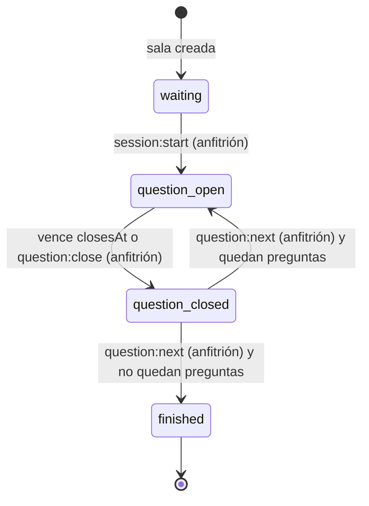
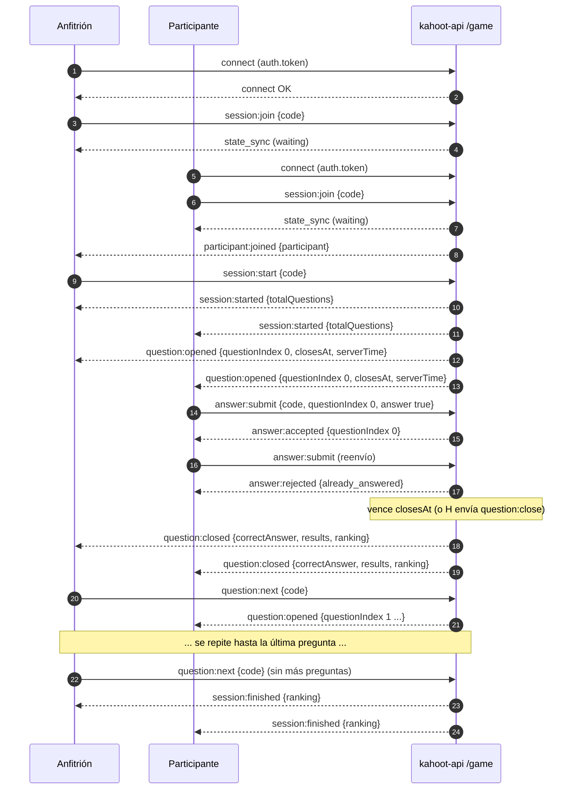
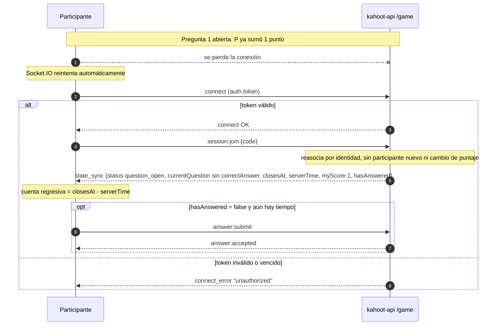

# Catálogo de eventos en vivo (kahoot-api)

Contrato del canal en tiempo real de la partida. Versión de contrato: **1.0 (borrador para congelar)**. Los payloads están definidos como JSON Schema (draft 2020-12) en [`schemas/`](./schemas); cada evento tiene un esquema con el mismo nombre (los `:` se escriben `.`, p. ej. `session:join` -> `schemas/session.join.schema.json`; `state_sync` -> `state-sync.schema.json`). Los esquemas incluyen `examples` validados con Ajv.

> Regla de oro: el servidor es la única fuente de tiempo y de estado. El cliente nunca decide puntajes ni si una respuesta llegó a tiempo.

## 1. Transporte y conexión

| Dato | Valor |
|---|---|
| Librería | Socket.IO |
| Servidor | `kahoot-api`, `http://localhost:3002` (local) |
| Namespace | `/game` |
| Autenticación | `auth: { token: "<JWT de auth-api>" }` en el handshake (`aud=kahoot-api`) |

```ts
import { io } from "socket.io-client";

const socket = io("http://localhost:3002/game", {
  auth: { token: jwt },          // handshake-auth.schema.json
  reconnection: true,            // reconexión automática (valor por defecto de Socket.IO)
});
socket.on("connect_error", (e) => { if (e.message === "unauthorized") /* ir a login */ });
socket.on("connect", () => socket.emit("session:join", { code }));
```

### Autenticación del canal

- El JWT lo emite `auth-api` y debe llevar `aud=kahoot-api`. El servidor lo valida en el handshake (firma, expiración, audiencia).
- Sin token, o con token inválido/vencido: la conexión **se rechaza** y el cliente recibe `connect_error` con `message: "unauthorized"`. No se llega a emitir ningún evento.
- La identidad (usuario) sale del token, nunca de los payloads. Por eso `session:join` solo lleva el código.
- Quién es anfitrión se decide en el servidor comparando el usuario autenticado con el dueño de la sala.

### Salas lógicas

Tras un `session:join` válido el servidor une el socket a la sala Socket.IO **`session:<code>`**. Todo evento "a la sala" se emite solo a esa sala; los mensajes de una sala jamás llegan a otra. Los eventos marcados "solo al emisor" se envían únicamente al socket que causó la acción.

### Reconexión y recuperación de estado

1. Si se pierde la conexión (red, suspensión del equipo, reinicio del servidor), el cliente Socket.IO reintenta solo.
2. Al volver a conectar, el cliente debe reenviar el handshake con el token (automático por `auth`) y emitir otra vez `session:join { code }` (se recomienda hacerlo dentro del manejador de `connect`).
3. El servidor reasocia por identidad: **no crea un participante nuevo, no emite `participant:joined` y no altera el puntaje**. Devuelve al socket a la sala `session:<code>` y le emite **`state_sync`**.
4. `state_sync` es la fuente de verdad para reconstruir la pantalla: estado de la sala, participantes, pregunta vigente (sin `correctAnswer` si sigue abierta), `closesAt`, `serverTime`, tu puntaje y si ya respondiste.
5. El cliente calcula la cuenta regresiva como `closesAt - serverTime` (desfase del reloj ya compensado), no con su propio reloj.
6. Respuestas enviadas mientras estaba desconectado se pierden salvo que hayan llegado antes; si reenvía una ya aceptada recibe `answer:rejected` con `already_answered` (no suma dos veces).
7. Una desconexión de red no emite `participant:left`; solo `session:leave` explícito lo hace.

## 2. Máquina de estados de la partida

Estados (`status`): `waiting`, `question_open`, `question_closed`, `finished`.



Notas:
- Las transiciones inválidas (p. ej. `question:next` con la pregunta abierta, `session:start` ya iniciada) devuelven `error { code: "INVALID_STATE" }` y el estado no cambia.
- Tras cerrar la última pregunta, `question:next` (o el cierre automático definido por el servidor) lleva a `finished` y se emite `session:finished`.
- El estado se persiste en cada transición; los temporizadores se reprograman al arrancar el servicio.
- Cierre y validación de respuestas están serializados por sala: una respuesta que llega "a la vez" que el cierre se resuelve según el reloj del servidor.

## 3. Reglas de juego

| Regla | Detalle |
|---|---|
| Control | `session:start`, `question:next` y `question:close` solo del anfitrión. De un no anfitrión: `error { code: "FORBIDDEN" }`, sin cambio de estado. |
| Una respuesta | 1 respuesta por participante y pregunta (único `(sesión, participante, pregunta)`). Un reenvío no se registra y responde `answer:rejected` (`already_answered`); no suma. |
| Tiempo | El servidor fija `closesAt` y cierra por temporizador. Una respuesta que llega después de `closesAt` según el reloj del servidor -> `answer:rejected` (`late`). Si la pregunta ya está cerrada -> `closed`. |
| Secreto | `correctAnswer` viaja **solo** en `question:closed` (y en `state_sync.lastClosed` si la sala ya está cerrada). Nunca en `question:opened` ni en `state_sync` con pregunta abierta. |
| Puntaje | 1 punto por acierto; 0 por error o sin respuesta. Sin bonificación por velocidad. |
| Clasificación | Orden por puntaje descendente; empates comparten `position`. `ranking` va en `question:closed` y `session:finished`. |
| Persistencia | Respuestas, puntajes y clasificación final se guardan al cerrar y al terminar; sobreviven a reinicios. |

Valores de `answer:rejected.reason`:

| reason | Cuándo |
|---|---|
| `already_answered` | Ya habías respondido esta pregunta. |
| `late` | Llegó después de `closesAt` (reloj del servidor). |
| `closed` | La pregunta ya fue cerrada (por el anfitrión o ya concluida). |
| `not_in_session` | El socket no se unió a la sala (falta `session:join`) o no es participante. |
| `invalid_state` | No hay pregunta abierta, o `questionIndex` no es el de la pregunta vigente. |

Códigos de `error.code`: `FORBIDDEN`, `ROOM_NOT_FOUND`, `INVALID_PAYLOAD`, `INVALID_STATE`, `INTERNAL_ERROR`.

## 4. Catálogo de eventos

### 4.1 Cliente -> servidor

| Evento | Quién | Payload (esquema) | Respuesta |
|---|---|---|---|
| `session:join` | Autenticado | [`{ code }`](schemas/session.join.schema.json) | `state_sync` al emisor; `participant:joined` a la sala si es nuevo |
| `session:start` | Solo anfitrión | [`{ code }`](schemas/session.start.schema.json) | `session:started` + `question:opened` |
| `question:next` | Solo anfitrión | [`{ code }`](schemas/question.next.schema.json) | `question:opened` o `session:finished` |
| `question:close` | Solo anfitrión | [`{ code }`](schemas/question.close.schema.json) | `question:closed` |
| `answer:submit` | Participante | [`{ code, questionIndex, answer }`](schemas/answer.submit.schema.json) | `answer:accepted` o `answer:rejected` |
| `session:leave` | Participante | [`{ code }`](schemas/session.leave.schema.json) | `participant:left` a la sala |

Ejemplos:

```jsonc
// session:join
{ "code": "K7P2QX" }
// session:start
{ "code": "K7P2QX" }
// question:next
{ "code": "K7P2QX" }
// question:close
{ "code": "K7P2QX" }
// answer:submit  (answer: true = Verdadero)
{ "code": "K7P2QX", "questionIndex": 0, "answer": true }
// session:leave
{ "code": "K7P2QX" }
```

### 4.2 Servidor -> cliente

| Evento | Destino | Payload (esquema) |
|---|---|---|
| `state_sync` | Solo el socket que se une/reconecta | [state-sync](schemas/state-sync.schema.json) |
| `participant:joined` | Sala | [participant-joined](schemas/participant-joined.schema.json) |
| `participant:left` | Sala | [participant-left](schemas/participant-left.schema.json) |
| `session:started` | Sala | [session-started](schemas/session-started.schema.json) |
| `question:opened` | Sala | [question-opened](schemas/question-opened.schema.json) |
| `answer:accepted` | Solo el emisor | [answer-accepted](schemas/answer-accepted.schema.json) |
| `answer:rejected` | Solo el emisor | [answer-rejected](schemas/answer-rejected.schema.json) |
| `question:closed` | Sala | [question-closed](schemas/question-closed.schema.json) |
| `session:finished` | Sala | [session-finished](schemas/session-finished.schema.json) |
| `error` | Solo el emisor del comando fallido | [error](schemas/error.schema.json) |

Esquemas auxiliares: [participant](schemas/participant.schema.json), [ranking-entry](schemas/ranking-entry.schema.json), [question-result](schemas/question-result.schema.json), [handshake-auth](schemas/handshake-auth.schema.json).

**`state_sync`** (reconexión en mitad de una pregunta abierta; nótese que no hay `correctAnswer`)

```json
{
  "code": "K7P2QX",
  "status": "question_open",
  "isHost": false,
  "participantId": "5b0f6c1e-5c1e-4b53-9d2a-0a6f5e8d1a11",
  "participants": [
    { "id": "5b0f6c1e-5c1e-4b53-9d2a-0a6f5e8d1a11", "displayName": "Ana" },
    { "id": "8c2d3f40-1a7b-4e9c-b3d5-6e7f8a9b0c12", "displayName": "Beto" }
  ],
  "totalQuestions": 5,
  "currentQuestion": {
    "questionIndex": 1, "total": 5,
    "statement": "El agua hierve a 100 °C al nivel del mar.",
    "imageUrl": null,
    "closesAt": "2026-11-15T15:00:30.000Z"
  },
  "closesAt": "2026-11-15T15:00:30.000Z",
  "serverTime": "2026-11-15T15:00:12.345Z",
  "myScore": 1,
  "hasAnswered": false
}
```

Campos por estado: en `waiting`, `currentQuestion` y `closesAt` son `null`; en `question_closed`, `currentQuestion` es la última pregunta y `lastClosed` trae el cierre (con `correctAnswer`); en `finished`, `ranking` trae la clasificación final.

**`participant:joined`**
```json
{ "participant": { "id": "8c2d3f40-1a7b-4e9c-b3d5-6e7f8a9b0c12", "displayName": "Beto" } }
```

**`participant:left`**
```json
{ "participantId": "8c2d3f40-1a7b-4e9c-b3d5-6e7f8a9b0c12" }
```

**`session:started`**
```json
{ "totalQuestions": 5 }
```

**`question:opened`** (sin respuesta correcta)
```json
{
  "questionIndex": 0, "total": 5,
  "statement": "Costa Rica no tiene ejército permanente.",
  "imageUrl": "http://localhost:3002/api/v1/images/9b2f1c4e-2d6a-4a53-8f0e-1a7d5c3b9e10.png",
  "closesAt": "2026-11-15T15:00:30.000Z",
  "serverTime": "2026-11-15T15:00:00.000Z"
}
```

**`answer:accepted`** (no revela si acertó)
```json
{ "questionIndex": 0 }
```

**`answer:rejected`**
```json
{ "questionIndex": 0, "reason": "already_answered" }
```

**`question:closed`** (único evento con `correctAnswer`)
```json
{
  "questionIndex": 0,
  "correctAnswer": true,
  "results": [
    { "participantId": "5b0f6c1e-5c1e-4b53-9d2a-0a6f5e8d1a11", "answered": true,  "correct": true,  "pointsAwarded": 1, "totalScore": 1 },
    { "participantId": "8c2d3f40-1a7b-4e9c-b3d5-6e7f8a9b0c12", "answered": false, "correct": false, "pointsAwarded": 0, "totalScore": 0 }
  ],
  "ranking": [
    { "position": 1, "participantId": "5b0f6c1e-5c1e-4b53-9d2a-0a6f5e8d1a11", "displayName": "Ana",  "score": 1 },
    { "position": 2, "participantId": "8c2d3f40-1a7b-4e9c-b3d5-6e7f8a9b0c12", "displayName": "Beto", "score": 0 }
  ]
}
```

**`session:finished`**
```json
{
  "ranking": [
    { "position": 1, "participantId": "5b0f6c1e-5c1e-4b53-9d2a-0a6f5e8d1a11", "displayName": "Ana",  "score": 4 },
    { "position": 2, "participantId": "8c2d3f40-1a7b-4e9c-b3d5-6e7f8a9b0c12", "displayName": "Beto", "score": 2 }
  ]
}
```

**`error`** (p. ej. un participante intenta iniciar la partida)
```json
{ "code": "FORBIDDEN", "message": "Solo el anfitrión puede iniciar la partida." }
```

**Handshake rechazado** (`connect_error` en el cliente, no es un evento `error`)
```json
{ "message": "unauthorized" }
```

## 5. Secuencias

### 5.1 Partida completa



### 5.2 Reconexión



## 6. Supuestos y puntos abiertos

- El cierre tras la última pregunta pasa a `finished` con `question:next` del anfitrión (consistente con "avanzar tras el cierre"). Si la implementación cierra la partida sola tras el último cierre, el payload de `session:finished` es el mismo.
- El código de sala (`code`) usa 4 a 10 caracteres alfanuméricos en mayúscula en los esquemas; ajustar si el OpenAPI de salas define otro formato.
- `participant.id` y `participantId` son UUID; `displayName` hasta 40 caracteres.
- `answer:accepted` no indica acierto: el resultado solo se conoce en `question:closed`.
- El anfitrión no es obligatoriamente participante: `state_sync.participantId` puede ser `null` y `myScore` 0.
- Una sola instancia de `kahoot-api` (sin adaptador Redis); el escalado horizontal queda fuera de alcance.
- Cambios a este contrato solo por PR del orquestador con versión incrementada.
